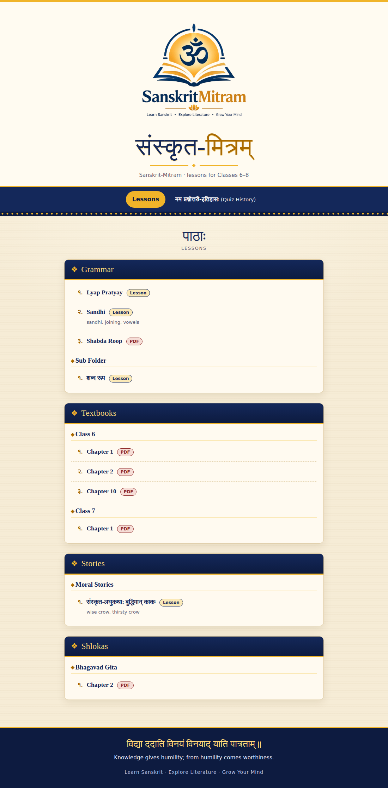
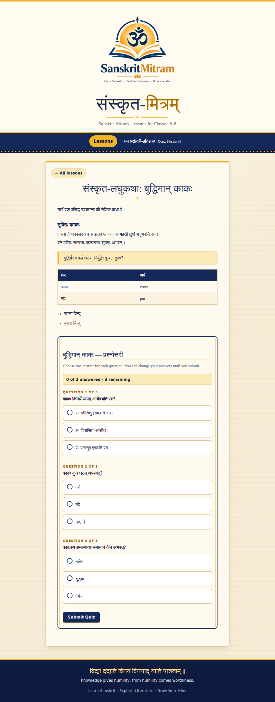
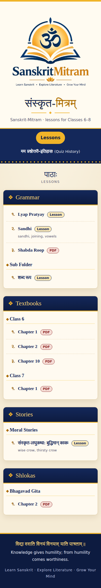
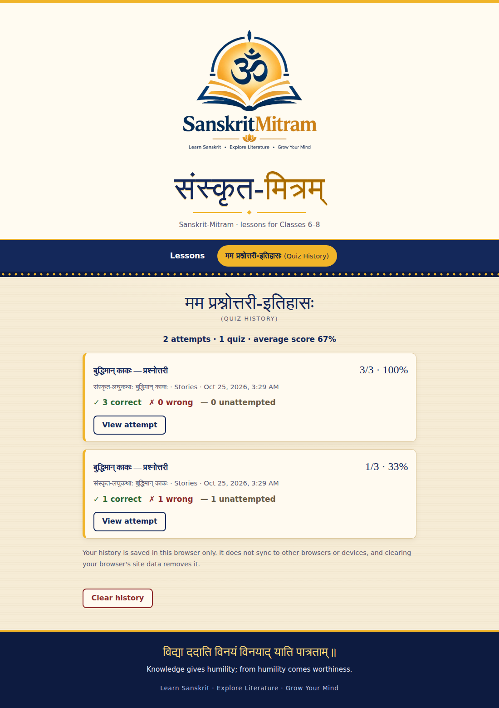

<div align="center">


# संस्कृत-मित्रम्
### Sanskrit-Mitram

**Your friendly companion for learning Sanskrit.**

*A free-first Sanskrit learning platform for Classes VI–VIII.*

Learn संस्कृतम्. Explore its wisdom. One lesson at a time.

<br />

<!-- Replace YOUR_USERNAME with your GitHub username -->

<a href="https://github.com/arnavpathi1472013-tech/SanskritMitram">
  
</a>


<br /><br />

**[Explore the Repository](https://github.com/arnavpathi1472013-tech/SanskritMitram)**
· **[Report a Bug](https://github.com/arnavpathi1472013-tech/SanskritMitram/issues)**
· **[Request a Feature](https://github.com/arnavpathi1472013-tech/SanskritMitram/issues)**

</div>

---

## ✨ What is Sanskrit-Mitram?

**Sanskrit-Mitram** is a student-focused project designed to make learning Sanskrit more accessible, organised, and engaging.

The goal is to bring Sanskrit lessons, explanations, and interactive learning experiences into one clean, easy-to-use platform.

Whether you're revising a श्लोक, learning व्याकरणम्, or studying your school syllabus, Sanskrit-Mitram aims to make the journey simpler.

<div align="center">

| 📚 Learn | 🧠 Practise | 🌱 Grow |
|:---:|:---:|:---:|
| Explore organised lessons | Test your understanding | Build your Sanskrit skills |

</div>

## 🖥️ A Look Inside

<div align="center">

<!-- Add actual screenshots to the screenshots/ directory. -->

| 🏠 Home Page | 📖 Lesson Reader |
|:---:|:---:|
|  |  |
| Your starting point for learning | Read lessons in a focused layout |

| 📝 Interactive Quiz | 📊 Quiz History |
|:---:|:---:|
|  |  |
| Practise what you've learned | Review your previous attempts |

</div>

## 🌟 Features

### 📚 Organised Learning

- Sanskrit lessons organised by category and topic.
- Support for Markdown-based lessons and PDF resources.
- A structure suitable for school-level Sanskrit learning.
- Content organised through the repository rather than hard-coded into every page.

### 🕉️ Sanskrit at the Centre

- Clear presentation of Sanskrit text.
- Support for Devanagari typography.
- Space for श्लोकाः, शब्दार्थाः, व्याकरणम्, and explanations.
- A learning experience designed around understanding, not just memorisation.

### 🧩 Interactive Learning

- Multiple-choice quizzes embedded in lesson content.
- Feedback after quiz submission.
- Explanations to help learners understand their answers.
- A quiz-attempt history for reviewing previous results.

### ⚡ Repository-Driven Content

One of the core ideas behind Sanskrit-Mitram is to make lesson management straightforward.

```text
Add or edit a lesson
        │
        ▼
Commit changes to GitHub
        │
        ▼
Automated content processing
        │
        ▼
Updated lesson catalogue
        │
        ▼
Website displays the content
```

The intended workflow uses repository files and GitHub Actions to process lesson content, avoiding the need to maintain a separate hard-coded catalogue manually.

### 💚 Free-First Philosophy

Sanskrit-Mitram is being designed with accessibility in mind.

- No paid backend is required for the planned static-site architecture.
- Lessons can be maintained as repository files.
- Browser-based features can work without requiring an account where authentication isn't necessary.
- Learning materials can be shared and improved through contributions.

*Availability of individual features depends on the current implementation.*

---

## 🎨 Design Philosophy

Sanskrit-Mitram should feel modern without losing the character of Sanskrit.

| Principle | What it means |
|---|---|
| 🪷 Sanskrit-first | Devanagari text deserves excellent readability. |
| 📱 Responsive | The interface should adapt to mobile, tablet, and desktop screens. |
| 🧭 Simple navigation | Learners should find lessons without unnecessary complexity. |
| ♿ Accessible | Readable typography, keyboard support, and clear interface states matter. |
| ⚡ Lightweight | Avoid unnecessary dependencies and expensive infrastructure. |
| 🌿 Student-friendly | Encourage curiosity, consistency, and understanding. |

## 🛠️ Built With

The technology stack includes:

<div align="center">


</div>

## 📂 Project Structure

The repository is intended to follow a structure similar to this:

```text
sanskrit-mitram/
│
├── index.html
├── style.css
├── script.js
│
├── shlokas/
│   └── vakratunda-mahakaya.md
│
├── assets/
│   └── ganesha.svg
│
├── screenshots/
│   ├── home.png
│   ├── lesson-reader.png
│   ├── quiz.png
│   └── quiz-history.png
│
├── data/
│   └── lessons.json
│
├── scripts/
│   └── generate_catalogue.py
│
├── .github/
│   └── workflows/
│
└── README.md
```

## 🚀 Getting Started

### Explore the project

1. Open the repository on GitHub.
2. Browse the lesson directories to explore the available content.
3. Check the source files to understand how the application works.

### Run locally

For a basic static website, you can use a local development server.

If Python is installed, open a terminal in the project directory and run:

```bash
python -m http.server 8000
```

Then open:

```text
http://localhost:8000
```

If the application relies on generated data, run the project's required build or content-generation steps before testing it.

> **Important:** A local server is preferable to opening `index.html` directly because browsers may restrict some local file operations.

## ✍️ Adding a Lesson

The repository-driven approach is intended to make adding content simple.

1. Choose the appropriate content directory.
2. Create a Markdown file (`.md`) or add a supported PDF.
3. Follow the project's lesson-format conventions.
4. Add images or other assets where needed.
5. Commit and push your changes.
6. Allow the configured GitHub Actions workflow to process the content.

For example, a shloka lesson might be stored at:

```text
shlokas/vakratunda-mahakaya.md
```

The actual folder structure and accepted lesson format should follow the repository's implementation.

## 🤝 Contributing

Learning grows when people share knowledge.

Contributions may include:

- 📖 New Sanskrit lessons.
- 📝 Corrections to grammar, translations, and explanations.
- 🧩 New quiz questions.
- 🎨 Interface and accessibility improvements.
- 🐛 Bug reports and fixes.
- 🌐 Better learning resources for students.

### Contribution workflow

```text
Fork the repository
        ↓
Create a branch
        ↓
Make your changes
        ↓
Test your changes
        ↓
Open a Pull Request
```

Please ensure that contributed Sanskrit content is accurate and that you have permission to share any material you submit.

## 🗺️ Roadmap

The roadmap below represents possible development milestones, not a list of completed features.

- [ ] Complete the core responsive interface.
- [ ] Build the lesson reader.
- [ ] Generate the lesson catalogue automatically.
- [ ] Support Markdown and PDF learning resources.
- [ ] Implement interactive quizzes.
- [ ] Add quiz history using browser storage.
- [ ] Improve accessibility and Devanagari typography.
- [ ] Test the deployment workflow.
- [ ] Add genuine application screenshots.
- [ ] Document lesson-authoring conventions.
- [ ] Explore Progressive Web App support.

## 🔒 Privacy & Data

Sanskrit-Mitram aims to keep its learning experience lightweight.

For features using browser-local storage:

- Quiz history is stored in the user's browser.
- Local records do not automatically synchronise across devices.
- Clearing browser storage may erase saved attempts.
- Browser storage should not be treated as a secure place for sensitive information.


## 💬 Feedback & Support

Found a bug? Have an idea for a better learning experience?

Open an issue in the repository and describe the problem or suggestion clearly.

Useful reports include:

- What you expected to happen.
- What actually happened.
- Steps to reproduce the issue.
- Screenshots, where relevant.

---

---

## 👨‍💻 Meet the Developer

<div align="center">


*Creator & Developer of Sanskrit-Mitram*

Building a better way to learn Sanskrit, one feature at a time. 🪷

<br />

<a href="mailto:arnav.pathi1472013@gmail.com">
  
</a>
<a href="https://www.instagram.com/arnav_pathi_147/">
  
</a>
<a href="https://github.com/arnavpathi1472013-tech">
  
</a>
<a href="https://github.com/arnavpathi1472013-tech?tab=repositories">
  
</a>

<br /><br />

**Have an idea, found a bug, or want to contribute?**

[Open an Issue](https://github.com/arnavpathi1472013-tech/SanskritMitram/issues)
· [Explore the Repository](https://github.com/arnavpathi1472013-tech/SanskritMitram)

<br />


<div align="center">

### संस्कृतं पठामः। संस्कृतं जानीमः।

**Let's learn Sanskrit, one step at a time.**

Made with dedication for Sanskrit learners. 🪷

<sub>Sanskrit-Mitram · A student-focused learning project</sub>

</div>
